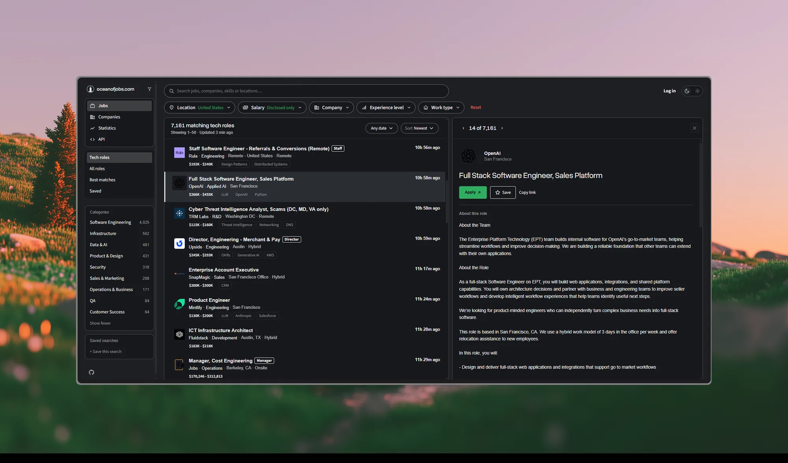

#  Ocean of Jobs

Open-source job board. Listings come straight from company hiring systems, are tracked over time, and are served through a public API and an MCP server that AI assistants can search.

As of October 2026 it holds over 1.2 million open jobs from about 22,000 companies, and 2 million listings tracked in total.

**Live site:** [oceanofjobs.com](https://oceanofjobs.com/)

| | |
|---|---|
| Job board | [/board](https://oceanofjobs.com/board) |
| Companies, A to Z | [/companies](https://oceanofjobs.com/companies) |
| Statistics | [/stats](https://oceanofjobs.com/stats) |
| Docs | [/docs](https://oceanofjobs.com/docs) |
| MCP server | `https://oceanofjobs.com/mcp`, setup in [/docs/mcp](https://oceanofjobs.com/docs/mcp) |
| REST API reference | [/docs/api](https://oceanofjobs.com/docs/api) |

**License:** MIT



## Use it from an AI assistant (MCP)

Ocean of Jobs runs a [Model Context Protocol](https://modelcontextprotocol.io) server at `https://oceanofjobs.com/mcp`. Add it to an assistant and ask things like "remote Kubernetes jobs posted this week" or "who is SentinelOne hiring in Tel Aviv". No account and no API key.

**Supported clients**, each with a step-by-step guide in the docs:

| Client | How it connects |
|---|---|
| [Claude Code](https://oceanofjobs.com/docs/mcp#claude-code) | `claude mcp add --transport http oceanofjobs https://oceanofjobs.com/mcp` |
| [Claude](https://oceanofjobs.com/docs/mcp#claude) (claude.ai, desktop) | Customize, Connectors, Add custom connector, paste the URL |
| [ChatGPT](https://oceanofjobs.com/docs/mcp#chatgpt) | Settings, Apps & Connectors, Developer mode, Create, paste the URL |
| [Cursor](https://oceanofjobs.com/docs/mcp#cursor) | One-click install link, or `~/.cursor/mcp.json` |
| [VS Code](https://oceanofjobs.com/docs/mcp#vs-code) | One-click install link, or `code --add-mcp` |
| [Gemini CLI](https://oceanofjobs.com/docs/mcp#gemini-cli) | `gemini mcp add -s user --transport http oceanofjobs https://oceanofjobs.com/mcp` |
| [Codex](https://oceanofjobs.com/docs/mcp#codex) | `codex mcp add oceanofjobs --url https://oceanofjobs.com/mcp` |
| [Hermes Agent](https://oceanofjobs.com/docs/mcp#hermes-agent) | `hermes mcp add oceanofjobs --url https://oceanofjobs.com/mcp` |
| [Kimi Code](https://oceanofjobs.com/docs/mcp#kimi-code) | `/mcp-config`, or a `url` entry in `mcp.json` |

Any other client that speaks Streamable HTTP works with the same URL ([other clients](https://oceanofjobs.com/docs/mcp#other-mcp-clients)).

**Tools.** Three, all read-only ([reference](https://oceanofjobs.com/docs/mcp#available-tools)):

- `search_jobs` searches titles, companies, locations and descriptions, with filters for company, city, country, seniority, workplace (remote, hybrid, on-site), posting age and minimum monthly salary (in shekels).
- `get_job` returns one listing in full: its description (up to 6,000 characters), the employer's apply link, and where else the same posting is listed.
- `get_company` takes a name or domain and returns its open-job count, jobs added this week, how long it has been tracked and its newest listings.

**Limits.** At most 25 results per call and an offset of 200. Answers may come from the edge cache for up to five minutes. Past the free daily capacity the server returns a JSON-RPC error until 00:00 UTC ([details](https://oceanofjobs.com/docs/mcp#limits-and-caching)). For bulk data use the [REST API](https://oceanofjobs.com/docs/api).

**How it runs.** The server is a Cloudflare Worker (`infra/mcp-worker.mjs`, deployed as `otj-mcp` by `scripts/deploy_mcp_worker.py`). It is stateless: each tool call becomes a GET on the public API with its parameters in a fixed order, so Cloudflare can cache it and the same question from the next person never reaches the box. A per-location rate limit caps how many cache misses get through. It has its own route, so switching it off never touches the board.

## Architecture

The core data store is SQLite on a single t4g.medium EC2 instance
(il-central-1): `jobs.db` for listings and companies, and `jobs-fts.db`
for the full-text search index, attached beside it. Both are
continuously replicated to Amazon S3 via Litestream.

`ARCHITECTURE.md` serves as the authoritative source for system design,
failure modes, and operational runbooks.

```
  scrapers                   box (EC2 t4g.medium)              readers
  ────────                   ────────────────────              ───────

  GitHub Actions ─┐
  daily, slow     │          ┌──────────────────────────┐
  guesses ATS     ├─ S3 ────►│ fetch_fragments.py (30s) │
  tokens          │  delta   │ shadow_apply.py  (timer) │
                  │  frags   ├──────────────────────────┤
  EventBridge ────┘          │ jobs.db  ~3GB  WAL       │──► Litestream ──► S3
  Lambda, 5 min              ├──────────────────────────┤
  re-polls known             │ publish.py       (timer) │──► artifacts ──► S3
  company/ATS pairs          ├──────────────────────────┤
  browser ──► Cloudflare ───►│ gunicorn -w 2 --threads 4│
              Worker         │   api/handler.py (WSGI)  │
  AI client ─► MCP Worker ──►└──────────────────────────┘
```

### Design rationale

**Stateless polling, stateful ingestion.** Light HTTP probing runs on AWS
Lambda to leverage low-cost, parallel execution (94% of polls return
`304 Not Modified`). Database ingestion and query serving run on the EC2
instance, which maintains local state and page cache for the ~3 GB
database.

**Concurrency control.** All write-heavy operations on the host
(`shadow_apply.py`, `publish.py`, snapshots) acquire a file lock
(`box/lock.py`) to prevent SQLite write contention.

### Core components

**1. Ingestion pipeline**

`scrape_handler.py` (Lambda, 5-min schedule): Executes `probe.py` using
`If-None-Match` headers across active ATS endpoints (Greenhouse, Lever,
Ashby, SmartRecruiters). Writes delta fragments to S3 without database
contact.

*Adaptive backoff:* Active boards poll every 5 minutes. Inactive boards
back off exponentially up to 4 hours, resetting to 5 minutes immediately
upon detecting new postings.

`scrape_workday_handler.py` (Lambda, hourly): Handles heavy and custom
targets pinned in `companies.yml` (Workday, custom corporate portals,
Oracle, Eightfold).

`box/fetch_fragments.py` and `box/shadow_apply.py` (EC2 timers):
`fetch_fragments.py` copies S3 fragments to a local spool every 30
seconds. `shadow_apply.py` processes the spool in 48 MB passes. The
decoupling prevents race conditions between Lambda fragment deletion and
EC2 ingestion cycles.

**2. API and routing**

`api/handler.py` (WSGI): Served via `gunicorn -w 2 --threads 4` reading
directly from `jobs.db`.

Routing (`infra/cloudfront.tf`, `infra/cloudflare-worker.js`):

```
/api/auth/*                 ──► CloudFront ──► AWS Lambda                 sign-in flows
/api/*                      ──► Worker ──► cloudflared ──► EC2 (:8000)    fast path
/mcp                        ──► MCP Worker (otj-mcp) ──► /api/* GETs      AI clients
/job/*, /company/*          ──► CloudFront ──► cloudflared ──► EC2 (:8000)
/docs/*                     ──► CloudFront ──► S3                         Next.js static export
/*                          ──► CloudFront ──► S3                         static assets
```

CloudFront can carry `/api/*` too, and does whenever the Worker is over
its free-plan budget of 100,000 requests a day: the route fails open and
CloudFront's own `/api/*` behavior reaches the same box through the same
tunnel, about 100 ms slower and less steady. A crawler spent that budget
on `/job/*` pages on 2026-09-25, which is why those pages are on
CloudFront (ten million free requests a month) and the Worker is not on
them.

*Rollback path:* The legacy Lambda stack remains deployed. Pointing the
behaviors back at the `api-lambda` origin restores full Lambda-based
execution.

**3. Discovery engine**

GitHub Actions (daily): Scans the Common Crawl URL index, verifies
endpoints, populates `domains.txt`, and resolves corporate identities.

**4. Pages for search engines**

Every listing has a server-rendered page at `/job/<id>` with JobPosting
structured data, and every company one at `/company/<domain>`. A closed
listing keeps its page for thirty days, marked closed and `noindex`, then
answers 410.

`loader/sitemap.py` runs with the box's publish job (at most every six
hours) and writes `sitemap.xml` with its shards, `feed.xml` (the newest
hundred listings as RSS), and the company directory at `/companies/a` to
`/companies/z`: plain links to every company page, so a crawler can walk
from the homepage to any listing without running JavaScript.

**5. Monitoring**

CloudWatch alarms (`infra/alarms.tf`) send email through SNS when a
source goes stale, the fast scraper errors or runs slow, or the
fragment backlog grows. A Grafana dashboard reads CloudWatch
(`infra/grafana_cloudwatch.tf`) for growth and search metrics. Job alerts
to users go out through Amazon SES.

### Storage and data strategy

**Optimized FTS indexing.** Job descriptions are stored individually in
S3 and retrieved on demand. Raw JSON payloads are discarded, while search
relies on a contentless SQLite FTS5 index. The index lives in its own
file, `jobs-fts.db` (about 1.8 GB, against 0.8 GB for `jobs.db`), so
rebuilding or vacuuming one never locks the other.

**Latency profile.** Active jobs reach the site within ~5 minutes of
posting. Ingestion onto EC2 occurs within 1–2 minutes of fragment
arrival.

## Authentication

Public job listings require no auth. Optional saved filters and email
alerts use AWS Cognito backed by Google OAuth, a custom Lambda flow for
GitHub OAuth, and passwordless Email OTP.

## Repository structure

| Path / file | Purpose |
|---|---|
| `probe.py` | Core ATS scraping engine supporting conditional HTTP requests. |
| `companies.yml` | Declarative pins for Workday, Comeet, and custom portal configurations. |
| `domains.txt` | Target domain resolution list. |
| `db/schema.sql` | DDL schema, including the contentless FTS5 virtual table. |
| `loader/` | Utilities for S3 description blobs (`descriptions.py`), deltas (`deltas.py`), and SQLite upserts (`load_to_sqlite.py`). |
| `box/` | Host-side daemons: fragment fetcher, applier, static publisher, and execution locking. |
| `api/` | WSGI application source code for the core API endpoints. |
| `alerts.py` | Saved search evaluation and email dispatch daemon. |
| `frontend/` | Framework-less vanilla UI: the landing page, board, companies, statistics, account, contact and privacy pages, one `style.css`, and plain JS beside them (`app.js`, `companies.js`, `auth.js`, `account.js`, `cv_skills.js`). |
| `docs/` | The docs site at `/docs`: Next.js and Fumadocs, exported to static files. MCP setup guides and the REST API reference. |
| `infra/` | Terraform manifests managing AWS resources and Cloudflare routing, plus the two Workers (`cloudflare-worker.js` for the API, `mcp-worker.mjs` for MCP). |
| `scripts/` | Operations: MCP Worker deploy and live check, origin key rotation, Cloudflare DNS (`cf.py`), Workers quota, local preview. |
| `ARCHITECTURE.md` | The current system in full, including failure modes. The authority. |
| `.github/workflows/` | CI/CD pipelines: discovery, and deploys for infra, the API, the box, the scrapers and the frontend with the docs. |
